<!-- Animated SVGs live in assets/ and are generated by tools/build_assets.py -->

  

  

  
  

 


<a href="https://blop77.github.io/cyclone-sentinel/story.html">
  
</a>

  
  
  
  

A 40-storm forecast ensemble with wind, surge and flood physics, Google Gemini reading the satellite image and writing alerts in Odia, Telugu and Bengali, and a fact check against the model before anything reaches officials. Built by Team Nebula Nomads for <i>Build with AI: Code for Communities</i>, Track 5.

 


<table>
  <tr>
    <td width="50%" valign="top">
      <a href="https://github.com/Blop77/ScamKavach"></a>
      
English · हिंदी · मराठी &nbsp;|&nbsp; <a href="https://blop77.github.io/ScamKavach/">App</a> · <a href="https://youtu.be/ZSiKwxgo8hc">Video</a> · <a href="https://github.com/Blop77/ScamKavach">Code</a>

    </td>
    <td width="50%" valign="top">
      <a href="https://github.com/Blop77/SegSense"></a>
      
<a href="https://segsense.onrender.com">Demo</a> · <a href="https://www.youtube.com/watch?v=NkiM_M_79AE">Video</a> · <a href="https://github.com/Blop77/SegSense">Code</a>

    </td>
  </tr>
  <tr>
    <td width="50%" valign="top">
      <a href="https://github.com/Blop77/allowance"></a>
      
<a href="https://allowance-trqr.onrender.com">Demo</a> · <a href="https://youtu.be/2cGTZHkmjGI">Video</a> · <a href="https://github.com/Blop77/allowance">Code</a>

    </td>
    <td width="50%" valign="top">
      <a href="https://github.com/Blop77/Qloo"></a>
      
<a href="https://ridetaste.onrender.com">Demo</a> · <a href="https://youtu.be/au5etS24uRk">Video</a> · <a href="https://github.com/Blop77/Qloo">Code</a>

    </td>
  </tr>
  <tr>
    <td width="50%" valign="top">
      <a href="https://github.com/Blop77/Enigma"></a>
      
<a href="https://blop77.github.io/Enigma/">Open</a> · <a href="https://github.com/Blop77/Enigma">Code</a>

    </td>
    <td width="50%" valign="top">
      <a href="https://github.com/Blop77/Hand-Tracker"></a>
      
<a href="https://blop77.github.io/Hand-Tracker/">Open</a> · <a href="https://github.com/Blop77/Hand-Tracker">Code</a>

    </td>
  </tr>
  <tr>
    <td width="50%" valign="top">
      <a href="https://github.com/Blop77/Mystic-Hands"></a>
      
<a href="https://blop77.github.io/Mystic-Hands/">Open</a> · <a href="https://github.com/Blop77/Mystic-Hands">Code</a>

    </td>
    <td width="50%" valign="top">
      <h4>🧪 C coursework</h4>
      <ul>
        <li><a href="https://github.com/Blop77/FOP_Mini_Project_Div-7">Expense tracker mini project</a></li>
        <li><a href="https://github.com/Blop77/Foundation-Of-Programming-Assignments-1-22-">Foundation of Programming assignments 1–22</a></li>
        <li><a href="https://github.com/Blop77/C-programming-Certificate">C programming certificate</a></li>
      </ul>
    </td>
  </tr>
</table>

 


  

  
  
  
  

 


  
  

  

  <picture>
    <source media="(prefers-color-scheme: dark)" srcset="https://raw.githubusercontent.com/Blop77/blop77/output/snake-dark.svg" />
    <source media="(prefers-color-scheme: light)" srcset="https://raw.githubusercontent.com/Blop77/blop77/output/snake.svg" />
    
  </picture>

